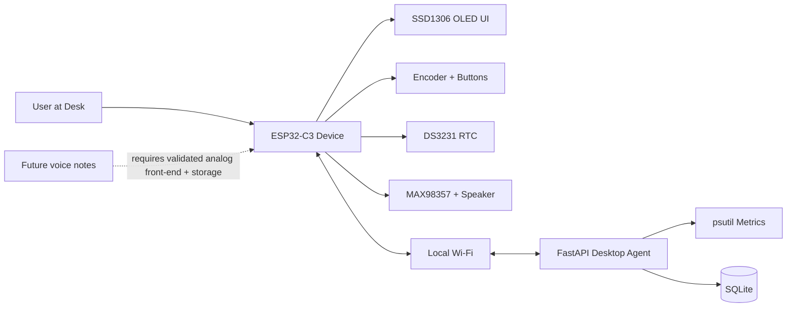

# SENU Architecture

## Component responsibilities

## Firmware (`/firmware`)

- Render local UI and status on OLED.
- Handle physical input (encoder/buttons).
- Maintain offline-capable clock/focus timer behavior (RTC-assisted).
- Request desktop metrics over local HTTP/JSON when available.

## Desktop agent (`/desktop_agent`)

- Provide local API endpoints for health and host metrics.
- Gather CPU and memory usage via `psutil`.
- Serve as integration point for future task data and local SQLite persistence.

## Persistence (planned)

- SQLite in desktop agent scope for cached task/timer/events data.
- Firmware should not depend on cloud connectivity for timer/clock core functions.

## Explicitly out of scope (initial scaffold)

- WebSockets
- Cloud backends
- Authentication infrastructure
- Assumed-ready voice capture pipeline
